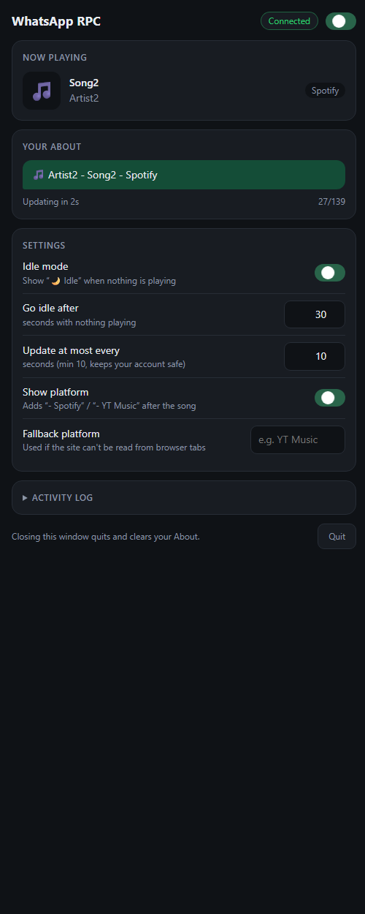

# whatsapp-rpc

Discord-style "Rich Presence" for WhatsApp. It watches what you're playing on your PC and mirrors it into your WhatsApp **About** text:

```
🎵 Maroon 5 - Memories - YT Music
🌙 Idle - brb, dinner
```

Works with anything that shows up in the Windows media overlay: **Spotify, YouTube Music, SoundCloud, Apple Music, Deezer, Tidal**, and others.



> **Unofficial.** This uses [whatsapp-web.js](https://github.com/pedroslopez/whatsapp-web.js), which automates WhatsApp Web. WhatsApp doesn't allow unofficial clients, so there is a risk your number gets restricted. Use at your own risk, ideally on a number you can afford to lose. It also depends on WhatsApp Web internals, so it can break whenever WhatsApp updates.

## Features

- **App window:** QR login, a now-playing card, a live preview of your About, settings and an activity log. No terminal needed after starting it.
- **Platform detection:** shows `- Spotify`, `- YT Music`, `- SoundCloud`... after the song.
- **Idle mode:** when nothing has played for a while it shows `🌙 Idle`, and the window asks what message to add.
- **Statuses:** pick `💻 Coding`, `🎮 Playing Minecraft`, `🍿 Watching Breaking Bad`, `😴 Sleeping`, `🏫 School`... from the window. Add your own, with an optional blank to fill in each time (like a game name).
- **Automations:** turn statuses on by themselves on chosen days and hours (e.g. School on weekdays 08:00-15:00, Sleeping every night 23:00-07:00).
- **Sync switch:** pause everything with one toggle (this clears your About).
- **Safe by default:** updates are throttled, and closing the window clears your About.

## Requirements

- Windows 10/11 (uses the Windows media session API)
- Node.js 18+
- A Chromium-based browser (Brave, Chrome, Edge). It's used both for the app window and to run WhatsApp Web. Puppeteer's own Chromium download is skipped.

## Setup

```powershell
git clone https://github.com/VloStudios/whatsapp-rpc.git
cd whatsapp-rpc
npm install
npm start
```

An app window opens. On first run scan the QR code with WhatsApp under **Linked devices**. The session is saved in `.wwebjs_auth/` (git-ignored), so you only scan once.

If your browser isn't Brave, point to it:

```powershell
$env:BROWSER_PATH = "C:\Program Files\Google\Chrome\Application\chrome.exe"
npm start
```

Closing the window (or the **Quit** button) stops the app and clears your About. If no window opens, the console prints a `http://127.0.0.1:3737` address you can open in any browser.

## How it works

1. `smtc.ps1` reads the Windows media session (SMTC) and prints a JSON line whenever the track or play state changes. For browser players it reads open tab titles to tell YT Music, SoundCloud, etc. apart.
2. `index.js` turns that into text and sets your About through WhatsApp Web (headless Chromium).
3. `gui.js` serves the window from a small local web server (`127.0.0.1` only) and pushes live updates to it.

The text is capped at 139 characters; the platform is always kept and the song gets shortened first.

## Statuses

Click a status in the **Status** card to show it instead of the music text. It stays until you press **Clear** (or click it again), then music and idle mode take over again.

- **Starter set:** 💻 Coding, 🎮 Playing {}, 🍿 Watching {}, 😴 Sleeping, 🏫 School, 📚 Studying, 💼 Working, 🍽️ Eating, 🏋️ At the gym, 🚗 Driving.
- **Notes:** a status like Coding takes an optional note, so you can show `💻 Coding - whatsapp-rpc`.
- **Fill in the blank:** a `{}` in the name is something you type each time. `Playing {}` asks which game, shows `🎮 Playing Minecraft`, and remembers recent games as one-click chips.
- **Your own:** under **Manage statuses**, add an emoji and a name (use `{}` for a blank, e.g. `Reading {}`), remove any you don't want, or reset to the defaults.

Statuses are saved in `settings.json`. The one that's active is not: the app always starts back on automatic music/idle mode.

## Automations

Automations switch a status on by themselves. In the **Automations** card, add a rule with:

- a **status** (and its blank or note, e.g. `Watching` + `Breaking Bad`),
- the **days** it applies to (Every day, Weekdays, Weekends, or pick any),
- a **time interval**, e.g. `09:00 → 17:00` for School, `22:00 → 07:00` for Sleeping.

Rules can be switched on/off individually, and there's a master switch for all of them.

- **Overnight intervals** work: `22:00 → 07:00` on Monday runs until Tuesday 07:00, so it follows the day it *starts* on.
- **Priority:** if several rules match, the first one in the list wins. A status you pick yourself always overrides an automation; clear it and the automation takes over again.
- **Order of what's shown:** your own status → automation → music → idle.
- **Time zone:** uses your computer's local time. The app has to be running for automations to fire, and the schedule is checked every 15 seconds.

## Settings

Change these in the window. They're saved to `settings.json` (git-ignored).

| Setting | Default | What it does |
| --- | --- | --- |
| Idle mode | on | Show `🌙 Idle` when nothing is playing |
| Go idle after | 30 s | How long nothing must play before going idle |
| Update at most every | 20 s | Throttle between About updates (minimum 10 s) |
| Show platform | on | Adds the platform after the song |
| Fallback platform | none | Used when the site can't be read from browser tabs, e.g. `YT Music` |

Environment variables still work as defaults before first use: `BROWSER_PATH`, `GUI_PORT` (default `3737`), `SETTINGS_FILE` (where settings are saved), `NO_WINDOW=1` (don't open the window), `ABOUT_DURATION` (seconds until the About expires, `-1` = never), `IDLE_AFTER_SECONDS`, `MIN_INTERVAL_SECONDS`, `DEFAULT_BROWSER_PLATFORM`.

## Notes

- **Browser players:** Windows only reports "Brave" or "Chrome", so the site is guessed from open tab titles. A browser name is never shown as the platform. If the site can't be found it reuses the last one seen, then the fallback setting, then omits it.
- **Local server:** the window talks to a server bound to `127.0.0.1`. Requests are checked for host name, content type and a per-run token, so other websites can't control it.
- **Privacy:** the login session lives in `.wwebjs_auth/`. Never commit or share it; it's already in `.gitignore`.
- **`npm audit`:** reports vulnerabilities in transitive dependencies of whatsapp-web.js (Puppeteer's download and archive tooling). They aren't reachable here since no browser is downloaded and no FTP or zip handling is used.

## License

MIT, see [LICENSE](LICENSE).
